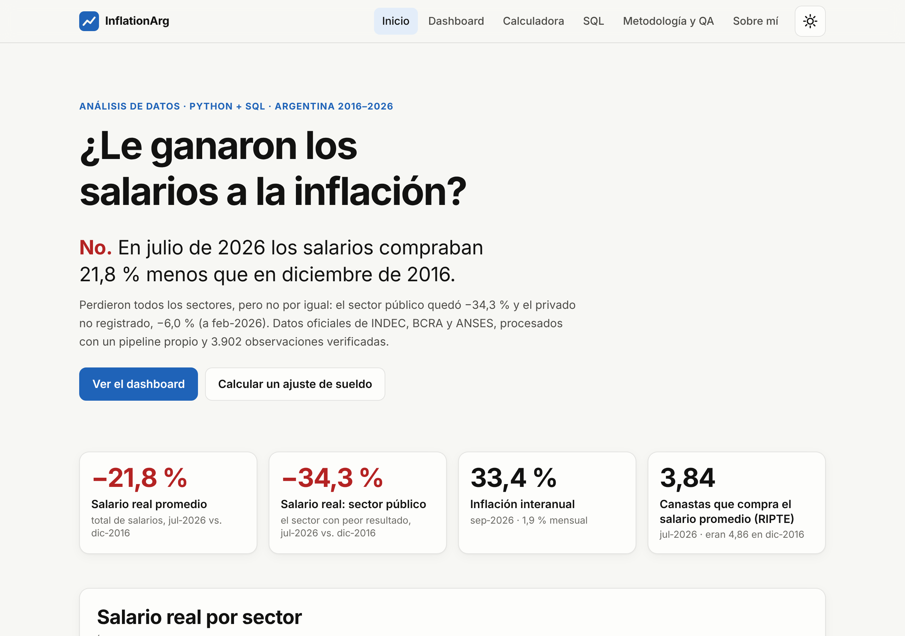
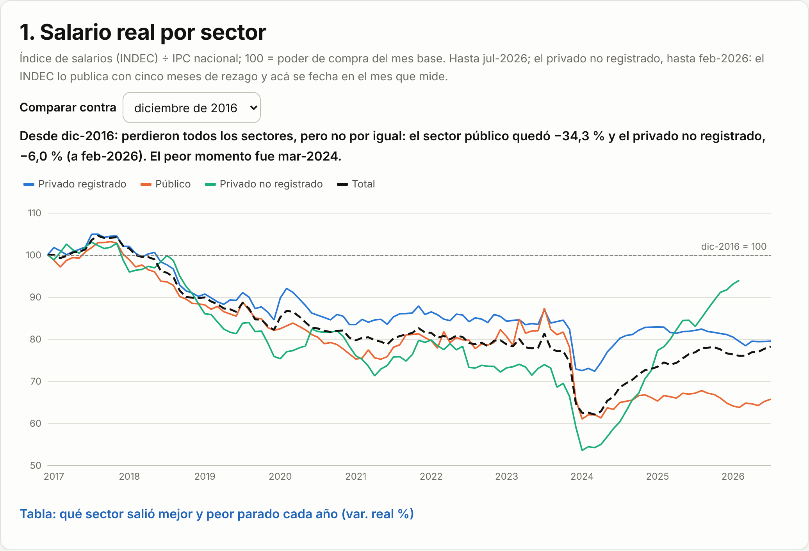
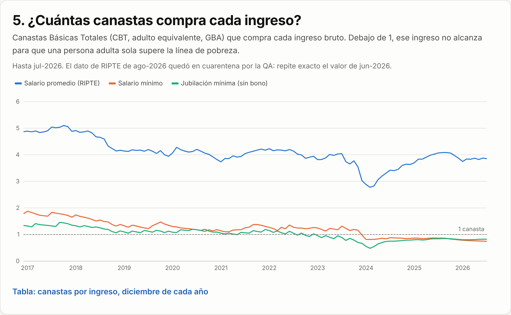
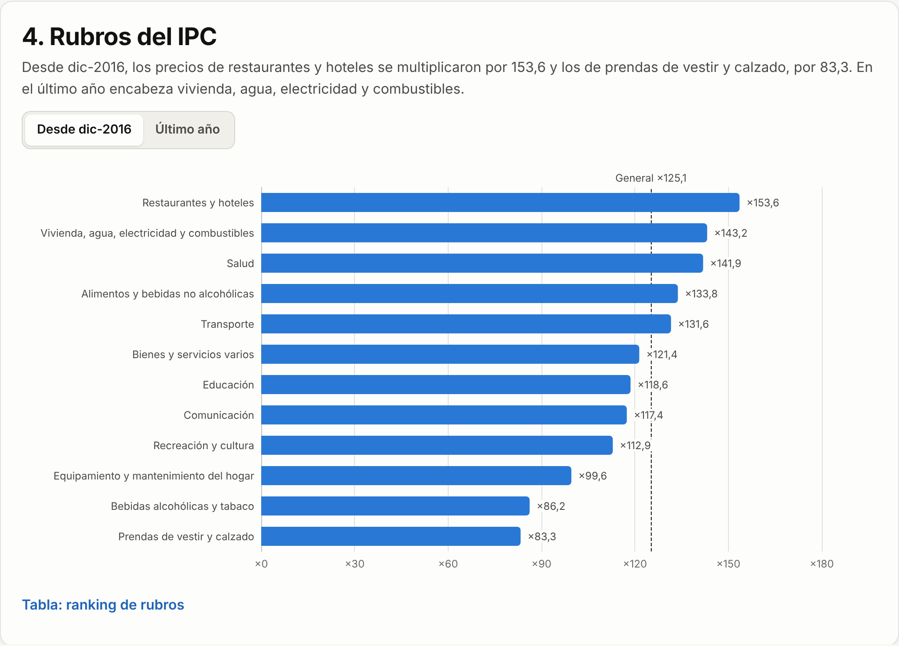
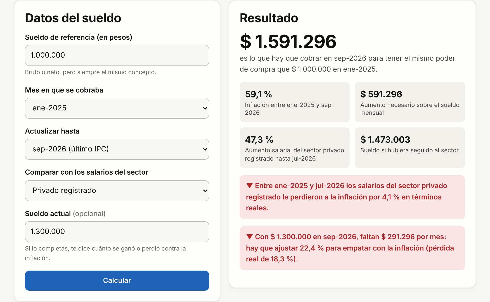
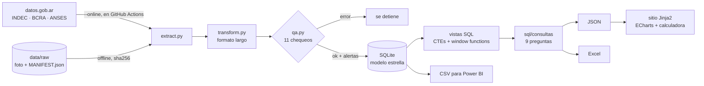
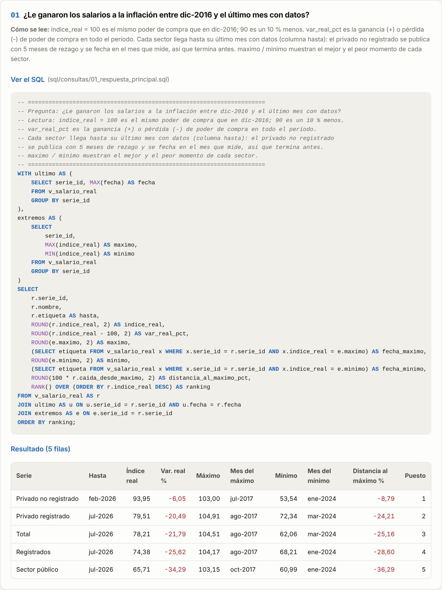

# ¿Le ganaron los salarios a la inflación? Argentina 2016–2026

[](https://github.com/JuanMBF/InflationArg/actions/workflows/ci.yml)
[](https://juanmbf.github.io/InflationArg/)

**Sitio en vivo: [juanmbf.github.io/InflationArg](https://juanmbf.github.io/InflationArg/)** · Dashboard · Calculadora de ajuste salarial · SQL · QA de datos

> **In English.** A data analysis portfolio project built with **Python, SQLite and SQL**. It answers one business question with official Argentine data (INDEC, BCRA, ANSES): *did wages keep up with inflation between 2016 and 2026?* (Short answer: no. By July 2026 average real wages were 21.8 % below December 2016, and public-sector wages 34.3 % below.) A single command runs the whole pipeline offline in about a second: checksum-verified extraction, an automated **data-quality suite** that caught real anomalies in the official sources, a **star schema** with SQL views using CTEs and window functions, one documented SQL query per business question, an **Excel** report, a **Power BI**-ready model, and a static website with an interactive dashboard and a salary-adjustment calculator for HR teams (same logic in Python and JavaScript, tested against the same cases). CI runs pytest, ruff, HTML validation and an accessibility audit (Playwright + axe) on every push.

<p align="center">
  
</p>

## La respuesta

**No.** Con la foto de datos del 21/10/2026, en julio de 2026 el salario promedio compraba **21,8 % menos** que en diciembre de 2016. Perdieron todos los sectores, pero no por igual:

| Sector (índice de salarios del INDEC ÷ IPC) | Salario real (dic-2016 = 100) | Peor momento |
|---|---:|---|
| Privado no registrado ¹ | 94,0 (−6,0 %) a feb-2026 | 53,5 en ene-2024 |
| Privado registrado | 79,5 (−20,5 %) a jul-2026 | 72,3 en mar-2024 |
| **Total** | **78,2 (−21,8 %)** a jul-2026 | 62,1 en mar-2024 |
| Público | 65,7 (−34,3 %) a jul-2026 | 61,0 en ene-2024 |

¹ El INDEC publica el índice del privado no registrado con cinco meses de rezago: el dato de julio refleja salarios de febrero. El modelo lo corre cinco meses (`dim_serie.desfase_meses`) antes de deflactarlo; sin ese ajuste, la caída de 2023–2024 aparecía casi el doble de profunda (un piso de 36 en lugar de 53,5). El índice total del INDEC incluye ese componente tal como se publica (pesa cerca del 20 %), así que su piso de 2024 se ve algo exagerado.



En el dashboard se puede **cambiar el mes base** ("Comparar contra"): la conclusión depende de desde dónde se mire, y el gráfico y el texto se recalculan para cualquier diciembre desde 2016.

### Hallazgos

1. **El piso fue en 2024 y la recuperación es parcial.** El salario real total tocó 62,1 en marzo de 2024; desde ahí recuperó 26,0 %, pero sigue 25,2 % debajo de su máximo (ago-2017).
2. **Diciembre de 2023 fue el peor mes:** 25,5 % de inflación mensual. La interanual llegó a 289,4 % en abril de 2024. En septiembre de 2026: 1,9 % mensual y 33,4 % interanual.
3. **Restaurantes y hoteles, el rubro que más subió.** Desde dic-2016 los precios se multiplicaron por 125,1 en promedio; restaurantes y hoteles, por 153,6, y prendas de vestir y calzado, por 83,3.
4. **El salario mínimo ya no cubre una canasta.** El RIPTE (salario promedio bruto de los registrados estables) compraba 4,86 Canastas Básicas Totales en dic-2016 y 3,84 en jul-2026; el salario mínimo compra 0,74 y está por debajo de 1 desde dic-2023.
5. **La inflación no fue igual en todo el país.** En el último año el NEA tuvo la más alta (36,9 %) y la Patagonia la más baja (30,3 %).
6. **En dólares oficiales, el RIPTE todavía está abajo de 2017:** US$ 1.275 de promedio en 2026 (7 meses) contra US$ 1.442 en 2017; el mínimo fue US$ 851 en 2020.

Todas estas cifras salen de la base: el sitio las genera desde las consultas SQL y los tests las verifican contra un cálculo independiente con pandas sobre los CSV oficiales.

<p align="center">
  
  
</p>

## Calculadora de ajuste salarial (para RR.HH.)

*¿Cuánto hay que ajustar un sueldo para no perder contra la inflación?* Se ingresa el sueldo y el mes en que se cobraba; la calculadora lo actualiza por IPC, lo compara contra lo que aumentaron los salarios del sector elegido y, si se carga el sueldo actual, dice cuánto se ganó o perdió en pesos y en %.

La lógica está escrita en [Python](inflationarg/calculadora.py) y en [JavaScript](site/static/js/calculadora.js), y **las dos pasan los mismos casos** de [`tests/casos_calculadora.json`](tests/casos_calculadora.json), cuyos valores esperados se calcularon aparte, directo de los CSV.



## Cómo está hecho



| Etapa | Qué hace | Dónde |
|---|---|---|
| Extracción | Lee la foto offline y verifica el sha256 de cada archivo contra [`MANIFEST.json`](data/raw/MANIFEST.json). En modo `--online` baja todo de datos.gob.ar con un User-Agent propio (la API responde 403 al de urllib). | [`extract.py`](inflationarg/extract.py) |
| Transformación | De los CSV anchos al formato largo `(fecha, serie_id, valor)` según un catálogo de 33 series. | [`config.py`](inflationarg/config.py), [`transform.py`](inflationarg/transform.py) |
| QA de datos | 11 chequeos con niveles ok / info / alerta / error y reporte en Markdown y JSON. | [`qa.py`](inflationarg/qa.py) |
| Modelo | `dim_fecha` (CTE recursiva), `dim_serie` (con el rezago de publicación de cada serie), `fact_valor` con `estado` de QA y cada valor fechado en el mes que mide. | [`sql/01_esquema.sql`](sql/01_esquema.sql), [`sql/02_modelo.sql`](sql/02_modelo.sql) |
| Vistas | Variaciones con `LAG()` protegido contra meses faltantes, salario real, `RANK()` de picos, caída desde el máximo con `MAX() OVER`, pivotes de poder de compra y dólares, cobertura. | [`sql/03_vistas.sql`](sql/03_vistas.sql) |
| Consultas | Una por pregunta de negocio, con un comentario que dice qué responde y cómo se lee. | [`sql/consultas/`](sql/consultas) |
| Entrega | JSON para el sitio, Excel con índice navegable, tablas con formato y gráfico nativo, CSV del modelo para Power BI, sitio estático. | [`export.py`](inflationarg/export.py), [`site.py`](inflationarg/site.py) |

<p align="center"></p>

## QA de datos

La suite corre antes de cargar la base: un **error** frena el pipeline; una **alerta** es una anomalía real que se documenta y, si corresponde, se aparta del análisis.

| Chequeo | Resultado con la foto del 21/10/2026 |
|---|---|
| Integridad (sha256 y filas vs. manifiesto) | ✅ 10 archivos idénticos byte a byte |
| Unicidad de fecha + serie | ✅ |
| Fechas mensuales contiguas | ✅ |
| Completitud del catálogo | ✅ 33 series |
| Base 100 (IPC dic-2016, salarios oct-2016) | ✅ 27 índices |
| Rangos plausibles | ✅ |
| Valores con fecha futura | ⚠️ El salario mínimo trae nov-2026 a abr-2027 (ya fijados por resolución): se excluyen |
| Valores repetidos sospechosos | ⚠️ **RIPTE ago-2026 = jun-2026 exacto** (1.915.878,76): queda con `estado = 'sospechoso'` y las vistas no lo usan |
| Consistencia API vs. CSV | ⚠️ La API devolvió **vacías** 4 series que en los CSV están completas (IPC NOA, recreación, restaurantes, RIPTE), NEA incompleta y valores distintos al CSV en abr-2019 (5 regiones) y en NEA jul-2022 (la API implica +4,3 % y +10,9 % en julio y agosto; el CSV, +7,4 % y +7,6 %) |
| Frescura | ✅ dentro del rezago habitual |
| Alineación | ℹ️ Salarios hasta jul-2026 (el privado no registrado, hasta feb-2026 por su rezago), IPC hasta sep-2026: cada conclusión dice hasta qué mes vale |

El reporte completo está en el sitio ([Metodología y QA](https://juanmbf.github.io/InflationArg/metodologia/)) y en `build/qa/reporte.md` después de correr el pipeline.

## Cómo correrlo

Requiere Python 3.11 o superior. Conviene un entorno virtual (en Ubuntu, Debian o el Python de Homebrew, `pip` no instala fuera de uno):

```bash
python3 -m venv .venv && source .venv/bin/activate   # Windows: .venv\Scripts\activate
pip install -r requirements.txt
python -m inflationarg all           # todo offline (~1 s): build/inflationarg.db, .xlsx, powerbi/, site/
python -m inflationarg qa            # solo la QA de datos
python -m inflationarg consulta 05   # corre sql/consultas/05_rubros_ranking.sql
python -m inflationarg all --online  # baja datos nuevos de datos.gob.ar
```

Para ver el sitio en local, generarlo con base `/` y servirlo:

```bash
INFLATIONARG_BASE=/ python -m inflationarg all && python -m http.server -d build/site
```

Tests y calidad:

```bash
pip install -r requirements-dev.txt && npm ci && npx playwright install chromium
# en Linux, si faltan librerías del sistema: npx playwright install --with-deps chromium
make test    # pytest con cobertura + tests de la calculadora en JS
make lint    # ruff
make sitio   # validación HTML + Playwright y axe en 375/768/1280, claro y oscuro
```

**Power BI:** el modelo estrella sale en `build/powerbi/` (o como `powerbi.zip` en el sitio). La guía para armar el dashboard está en [`docs/power-bi.md`](docs/power-bi.md).

### Automatización

- [`ci.yml`](.github/workflows/ci.yml): ruff, pytest (cobertura mínima 90 %), pipeline completo, tests de JS, validación HTML y auditoría de accesibilidad, con las capturas como artefacto.
- [`pages.yml`](.github/workflows/pages.yml): genera el sitio y lo publica en la rama `gh-pages` en cada push a `main` y **el día 20 de cada mes**. Siempre intenta bajar datos nuevos de datos.gob.ar y correr la QA: si pasan, publica con los datos nuevos; si fallan, publica con la foto del repo y la corrida queda en rojo para que se note.

## Diccionario de datos

**`fact_valor`** (una fila por serie y mes): `fecha` (primer día del mes), `serie_id`, `valor`, `estado` (`ok` o `sospechoso`).
**`dim_fecha`**: `fecha`, `anio`, `mes`, `trimestre`, `mes_idx` (`anio*12+mes`, para aritmética de meses), `etiqueta` (`sep-2026`).
**`dim_serie`**: `serie_id`, `nombre`, `grupo`, `region`, `unidad`, `base`, `fuente`, `archivo`, `columna`, `desfase_meses` (rezago de publicación: el dato fechado t mide el mes t − desfase).

| Grupo | Series | Unidad | Fuente |
|---|---|---|---|
| `ipc_region` | IPC nivel general: total país, GBA, Pampeana, NEA, NOA, Cuyo, Patagonia | índice dic-2016 = 100 | INDEC |
| `ipc_categoria` | IPC núcleo, regulados, estacionales | índice dic-2016 = 100 | INDEC |
| `ipc_rubro` | Las 12 divisiones del IPC (alimentos, vivienda, salud, etc.) | índice dic-2016 = 100 | INDEC |
| `salario_indice` | Índice de salarios: total, registrados, privado registrado, público, privado no registrado | índice oct-2016 = 100 | INDEC |
| `ingreso_pesos` | RIPTE, salario mínimo vital y móvil, haber mínimo jubilatorio | pesos corrientes | Seg. Social, MTEySS, ANSES |
| `canasta` | Canasta Básica Total y Alimentaria (adulto equivalente, GBA) | pesos | INDEC |
| `tipo_cambio` | Tipo de cambio oficial de valuación (promedio mensual) | pesos por dólar | BCRA |

**Límites:** el índice del privado no registrado se publica con cinco meses de rezago (se corrige en el modelo, pero el índice total del INDEC lo incluye sin corregir); el RIPTE cubre solo a trabajadores registrados estables y, como el salario mínimo, es un monto bruto (antes de aportes, cerca del 17 %); el haber mínimo jubilatorio no incluye el bono previsional que ANSES paga aparte; la CBT está valorizada para GBA; el dólar es el oficial (no paralelo).

## Estructura

```
inflationarg/      pipeline en Python (extract, transform, qa, db, export, site, calculadora)
sql/               esquema, modelo, vistas y consultas/ (una por pregunta)
data/raw/          foto de los CSV oficiales + MANIFEST.json con sha256
site/              plantillas Jinja2, CSS y JS del sitio
tests/             pytest, casos compartidos de la calculadora, tests de JS y QA del sitio
docs/              guía de Power BI y capturas
scripts/           imagen Open Graph y capturas del README
```

## Cómo lo hice

Lo desarrollé con **Claude Code**, un asistente de programación con IA: por eso la mayoría de los commits figuran a nombre de "Claude". La pregunta, el enfoque para RR.HH. y lo que tenía que mostrar el proyecto (Python, SQL, QA de datos, dashboard y calculadora) los definí yo. Cada parte está documentada y testeada para poder leerla, correrla y cambiarla.

## Sobre el autor

**Juan Barros** · Caballito, CABA. Busco mi primer puesto como **Analista de Datos Trainee/Junior** (también QA manual, BI/Reporting y Help Desk N1). Estudio la Tecnicatura en Desarrollo de Software y la Licenciatura en Gestión de TI en UADE; antes trabajé en soporte técnico y mesa de ayuda (Universidad Nacional Guillermo Brown) y en ventas (IDigital, +15 % en ventas cruzadas). SQL, Python, Excel avanzado, MySQL, MongoDB, Git, Docker y testing manual.

[juanmbarrosf@gmail.com](mailto:juanmbarrosf@gmail.com) · [LinkedIn](https://www.linkedin.com/in/barrosjuan0) · [GitHub](https://github.com/JuanMBF) · **[Portfolio con todos mis proyectos](https://juanmbf.github.io/Portfolio/)** · Repos: [Portfolio](https://github.com/JuanMBF/Portfolio), [ProyectoDB](https://github.com/JuanMBF/ProyectoDB), [HelpDesk Pro en Python](https://github.com/JuanMBF/python)

## Créditos y licencia

- Datos: [datos.gob.ar](https://datos.gob.ar) (INDEC, BCRA, ANSES, MTEySS, Secretaría de Seguridad Social), licencia [CC BY 4.0](https://creativecommons.org/licenses/by/4.0/deed.es).
- Gráficos: [Apache ECharts](https://echarts.apache.org) 6.1.0 por CDN con integridad SRI. Paleta categórica validada para daltonismo.
- Referencia de estructura para la sección del autor: el portfolio de analista de datos de [Keerthana R](https://keerthana-raghu.vercel.app), elegido de [emmabostian/developer-portfolios](https://github.com/emmabostian/developer-portfolios) por ser el perfil más parecido (presentación, proyectos, habilidades y contacto). No se copió código.
- Código: licencia [MIT](LICENSE).
